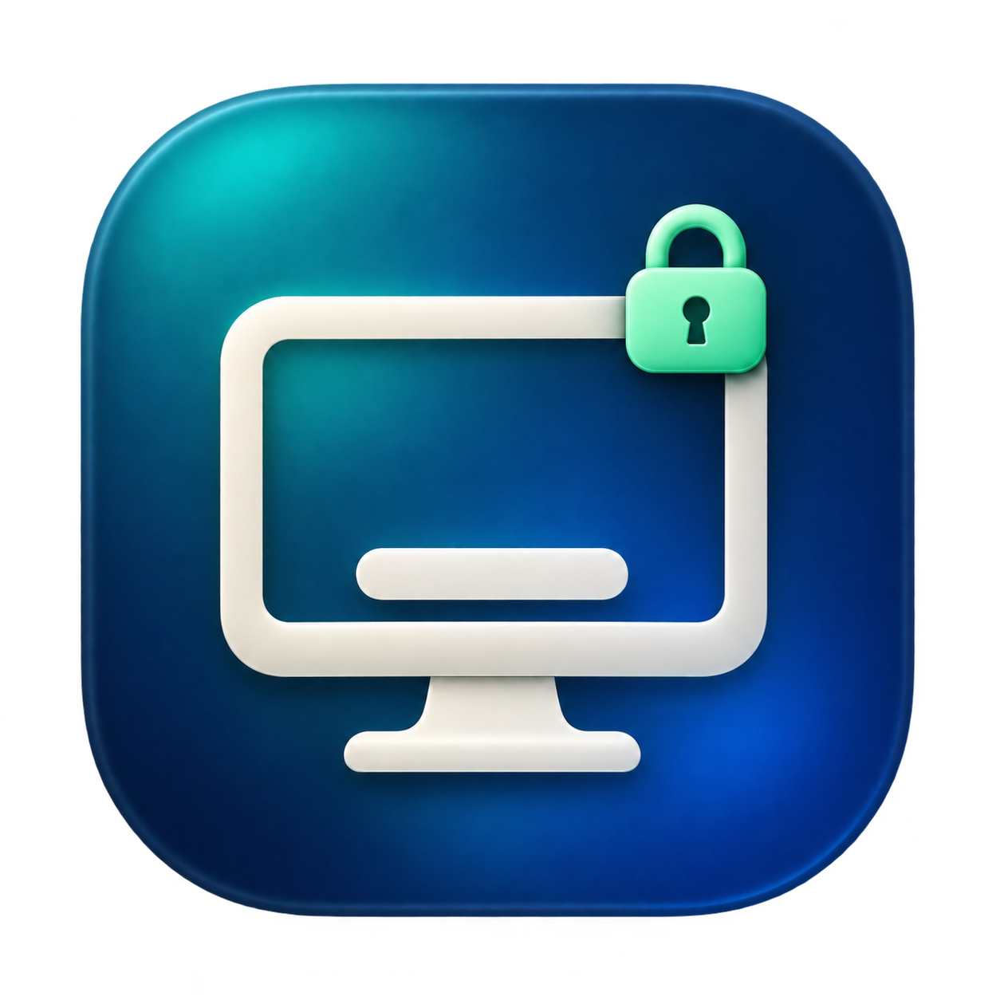
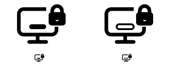

<div align="center">
  
  <h1>Dock Pin</h1>
  <p><strong>Your Dock. Your display.</strong></p>
  <p>A small native macOS menu bar app that helps keep the Dock on the display you choose.</p>
  <p>
    
    
    
  </p>
  <p><a href="#get-started">Get started</a> · <a href="#how-it-works">How it works</a> · <a href="#limitations">Limitations</a> · <a href="#build-from-source">Build from source</a></p>
</div>

---

Stop accidentally summoning the Dock on your other monitor. Choose a display, bring the Dock there once, and let Dock Pin guard the bottom edges of the others.

- **Choose your display.** Your preference is remembered by display UUID.
- **Stay out of the way.** One small menu bar icon, with no Dock icon or extra window.
- **Pause in a click.** Restore normal edge access whenever you need it.
- **Disconnect gracefully.** Protection pauses while your chosen display is absent and resumes when it returns.
- **Start at login.** Enable automatic startup from the menu.
- **Keep it local.** No network requests, accounts, analytics, or third-party dependencies.

## Get started

1. Open **Dock Pin.app**. Keep the app in a permanent location before granting permissions.
2. Click the **monitor-and-lock icon** in the menu bar and choose **Set Up Accessibility…**.
3. In **System Settings → Privacy & Security → Accessibility**, add Dock Pin and enable access. Restart the app if macOS requires it.
4. Choose your preferred display from the Dock Pin menu.
5. With the Dock positioned at the **bottom**, hold your pointer against the bottom edge of that display until the Dock appears.

The menu shows **Dock protection active** when the mouse filter is running. The little Dock bar inside the menu icon is filled while active and outlined while inactive. The tooltip explains the current status.

Use **Pause** to reach the very bottom edge of another display; choose **Resume** when you're done.

**Start at login:** choose **Start at Login** in the Dock Pin menu to launch the app automatically after signing in to macOS. Choose it again to disable automatic startup. The checkmark reflects the macOS setting. If approval is required, the menu shows **Start at Login (Approval Required)…** and opens Login Items in System Settings so you can approve or disable it. Automatic startup stays off until you enable it.

## How it works

Dock Pin uses a macOS mouse event tap to keep your pointer away from the bottom two logical points of other displays. This prevents the usual pointer gesture from moving the Dock there. Passage to a display immediately below another remains open.

The menu bar artwork is drawn as a native template image, so macOS renders it for light and dark appearances. The app icon is bundled as a full-resolution `.icns`, including Retina sizes.

<p align="center">
  
  <br><sub>Active (left) and paused (right), enlarged and at menu bar size.</sub>
</p>

### Privacy

Accessibility permission is required to adjust pointer movement. Dock Pin handles movement and drag events; it does not subscribe to keyboard or click events, save pointer history, or send data anywhere. Your selected display and pause preference are saved locally; macOS manages the optional login item.

## Limitations

Dock Pin is a preventive utility, not an official macOS Dock placement API.

| Situation | What to expect |
| --- | --- |
| Dock on the left or right | Protection pauses. Position the Dock at the bottom to use Dock Pin. |
| Interaction at another display's bottom edge | The bottom two logical points cannot be reached, including while dragging. Pause to reach them. |
| Sleep, Dock restart, or display changes | macOS can still move the Dock itself. Bring it back by holding the pointer at your chosen display's bottom edge. |
| Selected display disconnected | Protection pauses and resumes when that display returns. |
| Another screen directly below your chosen display | macOS may not allow the Dock on that edge. Choose an eligible display or adjust the screen arrangement. |
| “Displays have separate Spaces” disabled | macOS limits the Dock to the main display. Dock Pin does not override that setting. |

Dock Pin leaves your Dock and Spaces settings as they are and does not move the Dock automatically. See [Apple's Desktop & Dock guide](https://support.apple.com/en-gb/guide/mac-help/mchlp1119/mac) for the effect of separate Spaces.

## Build from source

Requires **macOS 13+** and **Xcode Command Line Tools** or Xcode. There are no packages to install.

```sh
zsh build.sh
open "build/Dock Pin.app"
```

The build creates the icon sizes, runs the self-checks, compiles the app, and signs it locally. The result is **`build/Dock Pin.app`**.

This is an ad-hoc signed local build, not a notarized distribution. Rebuilding or moving the app may require granting Accessibility permission again.

### Validation

The build runs eleven edge-policy checks covering the selected display, other displays, negative screen coordinates, interior movement, disconnected displays, vertical screen passage, positions outside all displays, and immediate upward escape after repeated fast downward movement. It also checks both menu icon states and all four login-item status indicators, decodes every app icon representation, and compares the small icons pixel by pixel against their source artwork. The bundle signature is verified after compilation.

Real multi-display behavior still needs a hands-on check with Accessibility access granted: try Dock migration, pause/resume, dragging, sleep/wake, and reconnecting the selected display.

## Remove

Turn off **Start at Login** if enabled (or remove Dock Pin in **System Settings → General → Login Items**), choose **Quit Dock Pin**, and delete the app. You can also remove its entry from Accessibility. No Dock or Spaces settings need to be restored.
